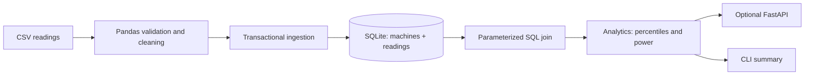

# Engineering Data Analytics Platform

A small, reproducible condition-monitoring data pipeline: validate CSV readings with Pandas, store them in SQLite, query a relational join, and calculate engineering summaries. An optional FastAPI service exposes the same data. The bundled measurements are **deterministic synthetic examples**, not hardware measurements.

## Quick start (Windows)

```powershell
cd engineering-data-analytics
py -3.11 -m venv .venv
.\.venv\Scripts\Activate.ps1
python -m pip install -e ".[test]"
python examples\generate_data.py
python -m engineering_analytics.cli ingest examples\data\machine_readings.csv
python -m engineering_analytics.cli serve
```

Open `http://127.0.0.1:8000/docs` or `http://127.0.0.1:8000/api/summary`. For PowerShell systems that restrict script activation, use `.\.venv\Scripts\python.exe -m pip install -e ".[test]"` and invoke that interpreter directly; do not change execution policy just for venv activation.

## Architecture



## Concepts and design

`machines` is a dimension table keyed by `machine_id`; `sensor_readings` is a time-series fact table with a composite key `(timestamp, machine_id)`. Foreign keys and CHECK constraints protect data integrity. Batch writes are transactional; input validation happens before writing; SQL uses bound parameters. The duplicate policy is “last row wins” for each machine/time pair.

The reported apparent power proxy is `S = V_rms I_rms` in volt-amperes. It is not real power: power factor is not measured. The p95 vibration value is the empirical 95th percentile, useful for examining upper-tail behavior without letting one extreme sample dominate like a maximum. Temperatures and speeds are summarized descriptively; this example does not infer faults.

## Experiments

- Generate the dataset again and check that its contents are reproducible.
- Add a duplicate timestamp with a changed voltage and observe last-row-wins cleaning.
- Add malformed numeric data and measure how many valid rows remain.
- Modify the synthetic vibration event in `examples/generate_data.py`; compare p95 with and without it.
- Import the same CSV twice and inspect the composite key behavior.
- Extend the join with a machine location or a time-range filter.

## Tests

```powershell
python -m unittest discover -s tests -v
```

The core suite covers validation, deduplication, error paths, database ingestion, joins, and summary statistics. API integration tests run when FastAPI and `httpx` test dependencies are installed. CI installs the test extra and runs both suites.

## Limitations and next steps

SQLite is appropriate for a portable local demo, not high-write multi-user telemetry. Data is synthetic, units are assumed by the schema, and the dataset has no missing/censored sensor status field. Future work: PostgreSQL adapter, time-window queries, alert thresholds based on calibrated limits, schema migrations, and dashboard plots.

## Interview preparation

1. **Why separate machine and reading tables?** The normalized schema avoids repeating machine metadata and provides a referential-integrity boundary.
2. **Why use a transaction for ingestion?** It makes a batch atomic: errors do not leave a partially imported batch.
3. **Why bind SQL parameters?** Values remain data instead of being interpolated into executable SQL, preventing injection and quoting mistakes.
4. **What does p95 communicate?** A robust view of high-end readings; it does not itself establish an alarm threshold.
5. **Why is `V × I` not real power?** AC real power also depends on phase/power factor; only voltage and current magnitudes are present here.
6. **How would you scale ingestion?** Batch insert, partition/time-series storage, indexes matched to query patterns, and measured throughput before changing databases.

## License

MIT. See [LICENSE](LICENSE).
